<h1 align="center">Hi! I am Harshit Sahu</h1>

<h3 align="center">DevOps Engineer | Cloud Infrastructure | Kubernetes | CI/CD Automation</h3>

  
  
  
  
  

<h2 align="center">
  
  &nbsp;Ａｂｏｕｔ Ｍｅ&nbsp;
  
</h2>

I build **cloud-native infrastructure** that teams can deploy, observe, and trust in production. My work sits at the intersection of automation, reliability, and clean delivery workflows.

- **Cloud infrastructure** — design and operate environments on AWS, Azure, and GCP
- **Containers** — package with Docker and orchestrate on Kubernetes
- **CI/CD** — automate delivery with Jenkins, GitHub Actions, and GitLab CI/CD
- **Infrastructure as code** — provision and configure with Terraform and Ansible
- **Observability** — monitor services with Prometheus and Grafana
- **Systems** — Linux administration, Python, and Bash automation

I enjoy building automation, improving deployment workflows, and contributing to open-source projects.

[Portfolio](https://harshit-sahu-portfolio-website.vercel.app/) · [LinkedIn](https://linkedin.com/in/harshitsahu2311) · [Email](mailto:harshitsahu2022@gmail.com) · [GitHub](https://github.com/harshitsahu2311) · [YouTube](https://youtube.com/@devopsenthusiast-23) · [Hashnode](https://hashnode.com/@harshit2311)

---

### 🚀 Languages - Frameworks - Tools - Libraries - Workspace 🚀

## Featured Projects

Hands-on DevOps and cloud Projects covering AWS, Kubernetes, CI/CD, Terraform, and observability. Code links go to public GitHub repositories I verified. Write-ups go to the matching Hashnode posts.

|                                                                                                                                                                                                                                                               |                                                                                                                                                                                                                                                            |
| ------------------------------------------------------------------------------------------------------------------------------------------------------------------------------------------------------------------------------------------------------------- | ---------------------------------------------------------------------------------------------------------------------------------------------------------------------------------------------------------------------------------------------------------- |
|  [DevOps Projects →](https://harshitsahu2311.hashnode.dev/series/devops-projects) CI/CD and Kubernetes walkthroughs: Jenkins, Argo CD, Wanderlust, Reddit clone, and related deployments.       |  [AWS Cloud →](https://harshitsahu2311.hashnode.dev/series/aws-cloud) IAM, VPC, CloudFormation, and AWS Organizations for multi-account infrastructure.                                                  |
|  [Terraform · Infrastructure as Code →](https://harshitsahu2311.hashnode.dev/series/terraform-infrastructure-as-code) Terraform foundations, AWS provisioning, state, and multi-environment infrastructure. |  [Certified Kubernetes Administrator →](https://harshitsahu2311.hashnode.dev/series/cka-k8s-path) CKA topics including cluster architecture, pods, and worker-plane troubleshooting. |

| Project                          | Focus                                                                                                                                                                                                                            | Links                                                                                                                                                                                                                     |
| -------------------------------- | -------------------------------------------------------------------------------------------------------------------------------------------------------------------------------------------------------------------------------- | ------------------------------------------------------------------------------------------------------------------------------------------------------------------------------------------------------------------------- |
| Terraform + EKS deployment       | AWS and Kubernetes infrastructure with Terraform and a Jenkins CI/CD path onto EKS                                                                                                                                               | [Code](https://github.com/harshitsahu2311/terraform-k8s-project) · [Write-up](https://harshitsahu2311.hashnode.dev/project-tf-k8s-deployment-in-eks-cluster)                                                              |
| AWS CI/CD pipeline               | Automated delivery with CodeCommit, CodeBuild, CodeDeploy, and CodePipeline onto EC2                                                                                                                                             | [Code](https://github.com/harshitsahu2311/AWS-DevOps-Project) · [Write-up](https://harshitsahu2311.hashnode.dev/project-aws-devops-deployment)                                                                            |
| Multi-environment Terraform      | Infrastructure as Code for separate AWS environments                                                                                                                                                                             | [Code](https://github.com/harshitsahu2311/Terraform-project) · [Series](https://harshitsahu2311.hashnode.dev/series/terraform-infrastructure-as-code)                                                                     |
| Amazon Prime clone on Kubernetes | CI/CD with image and code scanning, then Kind cluster deployment. Monitoring with Prometheus and Grafana is covered in the [Netflix clone write-up](https://harshitsahu2311.hashnode.dev/netflix-clone-deployment-on-kubernetes) | [Code](https://github.com/harshitsahu2311/Amazon-Prime-Clone-App) · [Write-up](https://harshitsahu2311.hashnode.dev/project-end-to-end-cicd-pipeline-of-amazon-prime-clone)                                               |
| Swiggy clone with GitHub Actions | Automated build and Kubernetes deploy using GitHub Actions                                                                                                                                                                       | [Code](https://github.com/harshitsahu2311/Swiggy-Clone-Deployment) · [Write-up](https://harshitsahu2311.hashnode.dev/deploy-a-swiggy-clone-using-github-actions)                                                          |
| Reddit clone with Ingress        | Kubernetes ingress and service routing                                                                                                                                                                                           | [Code](https://github.com/harshitsahu2311/reddit-clone-kubernetes-projects) · [Write-up](https://harshitsahu2311.hashnode.dev/ultimate-kubernetes-project-using-ingress)                                                  |
| Wanderlust GitOps                | GitOps and DevSecOps deployment of the Wanderlust app                                                                                                                                                                            | [Code](https://github.com/harshitsahu2311/Wanderlust-GitOps-Project) · [App repo](https://github.com/harshitsahu2311/Wanderlust-Project) · [Write-up](https://harshitsahu2311.hashnode.dev/project-wanderlust-deployment) |
| Centralized logging              | ELK stack walkthrough. I have not published a matching public repo for this, or for Loki                                                                                                                                         | [Write-up](https://harshitsahu2311.hashnode.dev/zero-to-hero-elk-stack) · Repo: `_add GitHub URL_`                                                                                                                        |

## 📊 My Github Stats

<h3 align="center">
  
  
  【Ｓｔａｔｓ】
</h3>

  

  

  
  

  
📈 More Stats

   

  

    
      
    
      
    
  

  

  

  <a href="https://github.com/harshitsahu2311">
    <picture>
      <source media="(prefers-color-scheme: dark)" srcset="https://raw.githubusercontent.com/harshitsahu2311/harshitsahu2311/output/github-snake-dark.svg">
      <source media="(prefers-color-scheme: light)" srcset="https://raw.githubusercontent.com/harshitsahu2311/harshitsahu2311/output/github-snake.svg">
      
    </picture>
  </a>

  <a href="https://github.com/harshitsahu2311">
    <picture>
      <source media="(prefers-color-scheme: dark)" srcset="https://raw.githubusercontent.com/harshitsahu2311/harshitsahu2311/output/pacman-contribution-graph-dark.svg">
      <source media="(prefers-color-scheme: light)" srcset="https://raw.githubusercontent.com/harshitsahu2311/harshitsahu2311/output/pacman-contribution-graph.svg">
      
    </picture>
  </a>

 
 
 
 
