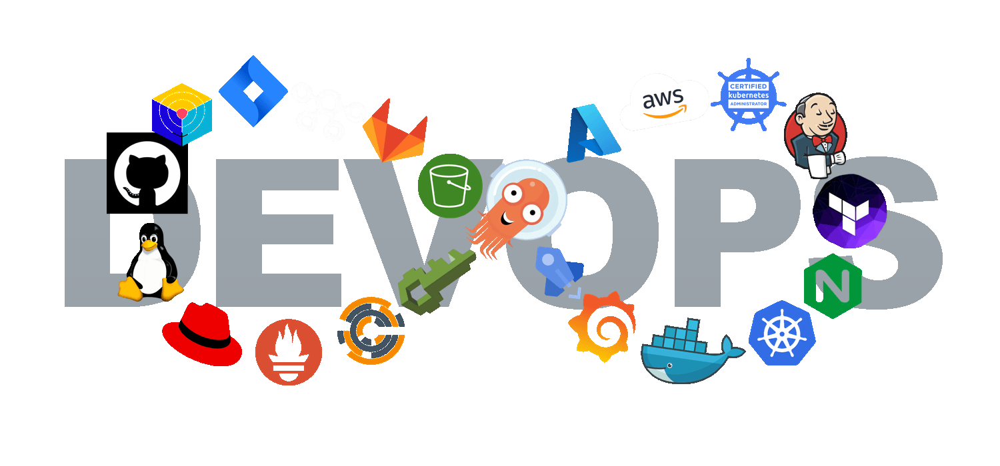
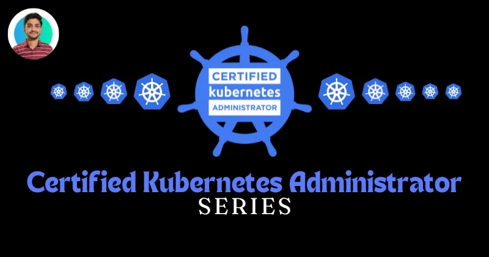

<h1 align="center">Hi, I'm Harshit Sahu</h1>

  <h3>DevOps Engineer | Cloud Infrastructure | Kubernetes | CI/CD Automation</h3>

  
  
  
  
  

  

  

<h2 align="center">
  
  &nbsp;Ａｂｏｕｔ&nbsp;Ｍｅ&nbsp;
  
</h2>

  

<table>
  <tr>
    <td width="62%" valign="top">
      I build <b>cloud-native infrastructure</b> that teams can deploy, observe, and trust in production. My work sits at the intersection of automation, reliability, and clean delivery workflows.

        

      
      &nbsp;<b>Cloud infrastructure</b> — design and operate environments on AWS, Azure, and GCP
       
      
      &nbsp;<b>Containers</b> — package with Docker and orchestrate on Kubernetes
       
      
      &nbsp;<b>CI/CD</b> — automate delivery with Jenkins, GitHub Actions, and GitLab CI/CD
       
      
      &nbsp;<b>Infrastructure as code</b> — provision and configure with Terraform and Ansible
       
      
      &nbsp;<b>Observability</b> — monitor services with Prometheus and Grafana
       
      
      &nbsp;<b>Systems</b> — Linux administration, Python, and Bash automation

        

      I enjoy building automation, improving deployment workflows, and contributing to open-source projects.

        

      
      
      
      
      
      
    </td>
    <td width="38%" valign="top" align="center">
      
       
      
    </td>
  </tr>
</table>

 

<h3 align="center" > 🚀 Languages - Frameworks - Tools - Libraries - Workspace 🚀</h3>

    

 

## Featured Projects

Hands-on DevOps and cloud work covering AWS, Kubernetes, CI/CD, Terraform, and observability. Code links go to public GitHub repositories I verified. Write-ups go to the matching Hashnode posts.

From the blog

  Click a series to open it. For the swipeable carousel, use the
  <a href="https://harshit-sahu-portfolio-website.vercel.app/">portfolio</a>.

<table>
  <tr>
    <td width="50%" valign="top">
      
       
      <a href="https://harshitsahu2311.hashnode.dev/series/devops-projects">DevOps Projects →</a>
       
      CI/CD and Kubernetes walkthroughs: Jenkins, Argo CD, Wanderlust, Reddit clone, and related deployments.
    </td>
    <td width="50%" valign="top">
      
       
      <a href="https://harshitsahu2311.hashnode.dev/series/aws-cloud">AWS Cloud →</a>
       
      IAM, VPC, CloudFormation, and AWS Organizations for multi-account infrastructure.
    </td>
  </tr>
  <tr>
    <td width="50%" valign="top">
      
       
      <a href="https://harshitsahu2311.hashnode.dev/series/terraform-infrastructure-as-code">Terraform · Infrastructure as Code →</a>
       
      Terraform foundations, AWS provisioning, state, and multi-environment infrastructure.
    </td>
    <td width="50%" valign="top">
      
       
      <a href="https://harshitsahu2311.hashnode.dev/troubleshooting-worker-plane-failure-cka">Certified Kubernetes Administrator →</a>
       
      CKA topics including cluster architecture, pods, and worker-plane troubleshooting.
    </td>
  </tr>
</table>

| Project | Focus | Links |
| --- | --- | --- |
| Terraform + EKS deployment | AWS and Kubernetes infrastructure with Terraform and a Jenkins CI/CD path onto EKS | [Code](https://github.com/harshitsahu2311/terraform-k8s-project) · [Write-up](https://harshitsahu2311.hashnode.dev/project-tf-k8s-deployment-in-eks-cluster) |
| AWS CI/CD pipeline | Automated delivery with CodeCommit, CodeBuild, CodeDeploy, and CodePipeline onto EC2 | [Code](https://github.com/harshitsahu2311/AWS-DevOps-Project) · [Write-up](https://harshitsahu2311.hashnode.dev/project-aws-devops-deployment) |
| Multi-environment Terraform | Infrastructure as Code for separate AWS environments | [Code](https://github.com/harshitsahu2311/Terraform-project) · [Series](https://harshitsahu2311.hashnode.dev/series/terraform-infrastructure-as-code) |
| Amazon Prime clone on Kubernetes | CI/CD with image and code scanning, then Kind cluster deployment. Monitoring with Prometheus and Grafana is covered in the [Netflix clone write-up](https://harshitsahu2311.hashnode.dev/netflix-clone-deployment-on-kubernetes) | [Code](https://github.com/harshitsahu2311/Amazon-Prime-Clone-App) · [Write-up](https://harshitsahu2311.hashnode.dev/project-end-to-end-cicd-pipeline-of-amazon-prime-clone) |
| Swiggy clone with GitHub Actions | Automated build and Kubernetes deploy using GitHub Actions | [Code](https://github.com/harshitsahu2311/Swiggy-Clone-Deployment) · [Write-up](https://harshitsahu2311.hashnode.dev/deploy-a-swiggy-clone-using-github-actions) |
| Reddit clone with Ingress | Kubernetes ingress and service routing | [Code](https://github.com/harshitsahu2311/reddit-clone-kubernetes-projects) · [Write-up](https://harshitsahu2311.hashnode.dev/ultimate-kubernetes-project-using-ingress) |
| Wanderlust GitOps | GitOps and DevSecOps deployment of the Wanderlust app | [Code](https://github.com/harshitsahu2311/Wanderlust-GitOps-Project) · [App repo](https://github.com/harshitsahu2311/Wanderlust-Project) · [Write-up](https://harshitsahu2311.hashnode.dev/project-wanderlust-deployment) |
| Centralized logging | ELK stack walkthrough. I have not published a matching public repo for this, or for Loki | [Write-up](https://harshitsahu2311.hashnode.dev/zero-to-hero-elk-stack) · Repo: `_add GitHub URL_` |

 

## 📊 My Github Stats

<h3 align="center">
  
  
  【Ｓｔａｔｓ】
</h3>

  

  

  
  

  
📈 More Stats

   

  

    
      
    
      
    
  

  

  

  <a href="https://github.com/harshitsahu2311">
    <picture>
      <source media="(prefers-color-scheme: dark)" srcset="https://raw.githubusercontent.com/harshitsahu2311/harshitsahu2311/output/github-snake-dark.svg">
      <source media="(prefers-color-scheme: light)" srcset="https://raw.githubusercontent.com/harshitsahu2311/harshitsahu2311/output/github-snake.svg">
      
    </picture>
  </a>

  <a href="https://github.com/harshitsahu2311">
    <picture>
      <source media="(prefers-color-scheme: dark)" srcset="https://raw.githubusercontent.com/harshitsahu2311/harshitsahu2311/output/pacman-contribution-graph-dark.svg">
      <source media="(prefers-color-scheme: light)" srcset="https://raw.githubusercontent.com/harshitsahu2311/harshitsahu2311/output/pacman-contribution-graph.svg">
      
    </picture>
  </a>

 
 
 
 

